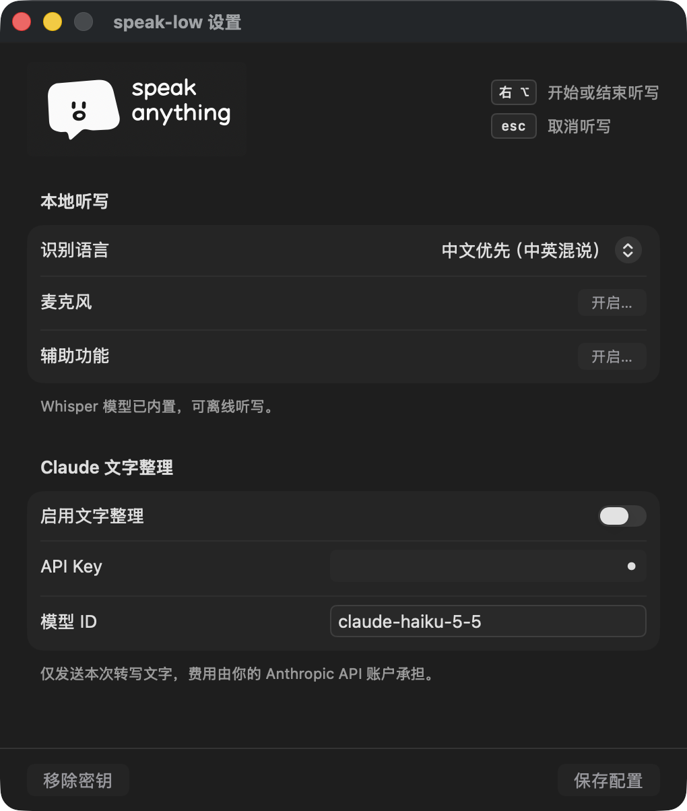
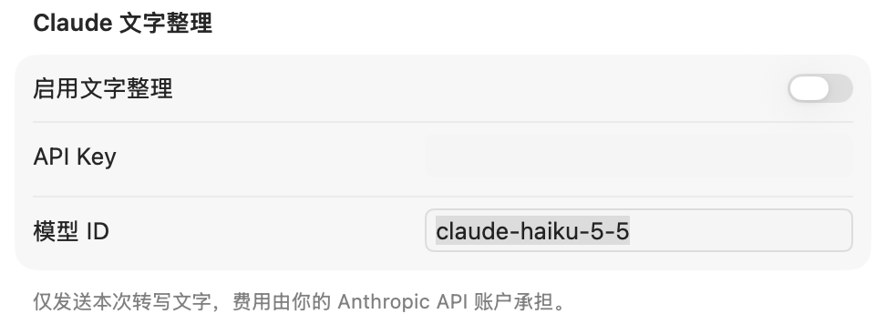

# speak-low


Mac 上的离线语音输入。把光标放进输入框，按一下右侧 **Option（⌥）** 开始说话，再按一下，把文字写回光标。按 **Esc** 取消。开始录音时会听到轻快的上行双音，结束时是下行双音。


## 安装与更新

需要 Apple Silicon Mac、macOS 14+、Swift 5.10+ 和 Python 3.8+。在仓库根目录运行：

```sh
./scripts/build-app.sh /Applications
open /Applications/speak-low.app
```

以后从菜单栏打开「设置」，点 **检查更新**。App 会读取私有仓库的 `main`，复用本机模型构建新版，并在听写结束后原位替换、重新打开。更新需要本机的 GitHub CLI 已通过 `gh auth login` 登录有仓库访问权的账号。

默认使用临时签名，更新后 macOS 可能要求重新授权。若要保留授权，首次用固定证书构建时设置 `SPEAK_LOW_SIGN_IDENTITY` 为钥匙串中代码签名证书的指纹，再为这个签名版本授权一次。之后点「检查更新」会沿用证书，并在安装前验证新版是否符合原 App 的签名要求。

首次构建会下载 Whisper 模型。打开 App，允许「麦克风」和「辅助功能」，等模型就绪即可听写。看到「已输入」表示已在原输入框中确认写入。若提示「未确认写入」，可从菜单栏气泡选择「复制上次结果」。



## 可选的 Claude 整理

在设置里填入自己的 Anthropic API Key 和模型 ID，保存后开启「启用文字整理」。Claude 可以合并断词、补标点。仅转写文字会发给 Anthropic，费用由你的 API 账户承担，调用失败时使用本地稿。


